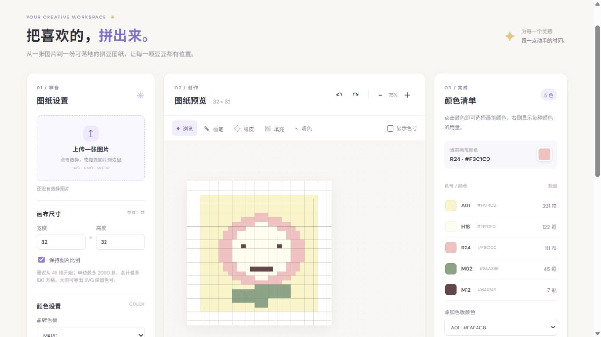

# Douge Bead Studio

Turn pictures into editable perler-bead patterns, in a browser or an offline Windows application.

Created by [LiangXiaotian-oat](https://github.com/LiangXiaotian-oat) with development assistance from OpenAI Codex (AI).

[Try the web app](https://liangxiaotian-oat.github.io/douge-bead-studio/) · [Alternative link](https://pindou-studio-creative.lushchime20.chatgpt.site/) · [Download for Windows](https://github.com/LiangXiaotian-oat/douge-bead-studio/releases/latest) · [中文](README.md)

- Preview and crop images; configure grid size, edge-background removal, color count, and dithering.
- MARD 221/291 sets, cross-brand reference mappings, and custom CSV palettes.
- Edit cells, count beads, and export PNG, SVG, CSV, and reusable project files.
- Basic processing stays on your device. Optional AI image editing requires your own compatible service and sends the image and API key to that service.

The grid is limited to 2,000 cells per side and one million cells in total. Large PNGs are previews; use SVG for cell labels. Cross-brand mappings are approximate reference data, not official manufacturer color cards.

Run the web app locally with `python -m http.server 4173 --directory web`. Windows x64 users can extract the release ZIP and run `豆格.exe`. For source builds, tests, CSV format, and full notes, see the [Chinese README](README.md).

Palette mapping data comes from [Zippland/perler-beads](https://github.com/Zippland/perler-beads). Licensed under [AGPL-3.0](LICENSE).
